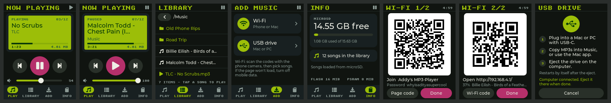

# Add music, buttons, earbuds (feature branch)

**Status:** `241abed` was flashed by the owner on 2026-11-20: boots, plays from SD, `wifi-on`
starts the AP (63 KB free heap). The changes below (2026-11-20 update) are compile + host-test
+ screenshot checked only. Known-good hardware baseline: `8f03337`.

## 2026-11-20 update: what changed

- **Upload page fix (likely cause: phone kept using mobile data).** The player now runs a DNS
  server that answers every name with 192.168.4.1 and answers the OS "is there internet?"
  probes (Android `/generate_204` `/gen_204`, Apple `/hotspot-detect.html`
  `/library/test/success.html`, Windows `/connecttest.txt` `/ncsi.txt`, Firefox `/success.txt`)
  like the real servers do. No captive-portal popup. `http://mp3.player/` also works (type the
  `http://`); the QR code and screen still use the IP.
- **Diagnostics:** each request is logged on serial as `HTTP GET /path`; `status` adds
  `http_requests=` (this Wi-Fi session) `stations=` `volume=` `gain_q12=`.
- **On-screen volume:** slider on Now Playing (0-100), saved in NVS 1.5 s after the last change.
  See [Volume](#volume).
- **New UI:** handheld look (dark body, green LCD window, magenta play button, pixel-font labels),
  custom bottom nav instead of the stock tab view, larger QR codes with a 4-module white quiet
  zone. Screens: [docs/ui](docs/ui/overview.png). Rendered on a PC from the same `src/PlayerUi.cpp`
  the firmware uses: `python tools/ui_preview/run.py` (Linux; gcc, plus g++-multilib for a
  32-bit build so LVGL heap numbers match the board).



## Needs a hardware check (this update)

1. **Upload page on the phone that failed** (Android + Chrome?): join, open `http://192.168.4.1`.
   Watch serial: no `HTTP GET /` line at all = the phone never sent it to the player (mobile
   data routing); `HTTP GET /generate_204` lines = DNS + probes work. If it still fails, turn
   off mobile data and retry. Also try `http://mp3.player/`.
2. iPhone too (Safari), and that no "Log in to network" popup appears.
3. The 5-min idle timeout still fires with a phone joined (background app traffic must not
   count; only page/API requests do).
4. Volume: slider feel, level after reboot, no distortion at 100 with the knob all the way up
   (if it distorts, lower `kSpeakerMaxGainQ12`), and VolumeUp/VolumeDown if mapped.
5. Earbuds build: boots at most at its default (74 = old 2/64) and never above 5/64.
6. New UI on the real LCD: colors, pixel font legibility, touch targets (nav, slider), QR
   scanning distance, LVGL heap with a 128-file folder (`status` heap; preview: 60 KB of 96 KB).

## Volume

- Slider 0-100 → digital gain before the DAC on a cubic curve (50 ≈ -18 dB). Gain is Q12
  (1/4096 steps) instead of the old Q6 (1/64); the old fixed gain is exactly `g*64` in Q12.
- Only the audio task changes the gain (`SET_VOLUME` command); the UI just queues it.
- Speaker: default **54** (= old 5/64, +0.05 dB), max = **-6 dB** below full scale (6.4x the old
  fixed level). No boost above unity.
- Earbuds: 100 on the slider = the old hard cap 5/64 (compile-time checked), default **74**
  (= old 2/64). Stored separately (`vol_ear`) and never restored above the default at boot.
- **The analog knob still sets the ceiling after the DAC.** Turn it fully up to let the slider
  cover the whole range.

New **Add** tab (tabs are now Play / Library / Add / Info):

## Wi-Fi upload (iPhone or Mac)

```
Add → Wi-Fi ─► player becomes Wi-Fi "Addy's MP3-Player" (pw whyisadityasupercool)
              screen: QR 1 = join Wi-Fi   ──(phone joins)──►   QR 2 = http://192.168.4.1/
              Safari page: Choose MP3s → per-song progress → "Done – turn off Wi-Fi"
```

- Music pauses while Wi-Fi is on (Wi-Fi and audio share CPU core 0).
- Wi-Fi turns itself off after **5 min with no requests** (not counted while a song is
  arriving), when the page/Mac app presses Done, or on the player's Done button.
- Uploads are raw `PUT /api/upload` bodies (name in `X-File-Name`, URL-encoded), streamed
  through a 32 KB buffer to `/Music/.upload-*.tmp`, size-checked, then renamed. Existing
  files are never overwritten: same name + same size = "already on the player",
  different size = `Name (2).mp3`. Leftover temp files are deleted next time.
- Names are made FAT-safe identically on the player (`sanitizeUploadName`) and in the
  Mac app (`PlayerName.forSong`): printable ASCII, no `\/:*?"<>|`, max 100 chars.
- Endpoints: `GET /`, `GET /api/status`, `GET /api/files`, `PUT /api/upload`,
  `POST /api/done`. Anything else is 404 (unexpected bodies are discarded, not buffered).
- DNS + connectivity-probe answers (see the update above) instead of a captive portal: the
  probes get "success", so no captive mini-browser (bad at file pickers on iOS). Android 10+
  also probes over HTTPS, which the player can't answer, so Android may still show
  "limited connectivity"; hence the on-screen "turn off mobile data" hint.

## USB drive (Mac/PC)

```
Add → USB drive ─► audio closes its file ─► card exported as "Addy MP3 Player" drive
                   computer copies into /Music ─► Eject on computer ─► player restarts
```

- The board's USB port normally is the USB-Serial/JTAG port (flashing + serial). Drive
  mode starts TinyUSB, which takes the port over, so **the COM port disappears** until
  the player restarts. Flashing and `inspect_player.py` are unchanged otherwise.
- Exit is always a restart (eject, Cancel, or 5 min without a computer). Before the
  restart the USB PHY is handed back to USB-Serial/JTAG (that setting survives a
  software reset). If the COM port ever doesn't come back, unplug/replug or hold
  BOOT + tap RESET.
- Cancel while a computer has the drive open asks for a second tap ("eject first").
- Writes `/.addys-mp3-player` so the Mac app can recognise the card.
- Dot-files (`._Song.mp3` from macOS, temp files) are now skipped by the scanner and
  the file browser.
- Build without it: remove `-DPLAYER_USB_DRIVE=1` in `platformio.ini`.

## Physical buttons

GPIO43 (J8 pin 9) and GPIO44 (J8 pin 10), each to GND, internal pull-ups. These are UART0
TX/RX: the boot ROM prints on GPIO43, so use a ~1 kΩ series resistor.

The mapping is a placeholder until it's decided. Change only the six lines in
`include/PlayerConfig.h`:

| | Single | Double | Long (0.7 s) |
| --- | --- | --- | --- |
| Button A (GPIO43) | Play/pause | — | — |
| Button B (GPIO44) | Next | Previous | — |

Actions available: `PlayPause`, `Next`, `Previous`, `Restart`, `WakeScreen`, `VolumeUp`,
`VolumeDown` (±5), `None`.
A button with no double/long action reacts on release; otherwise a single click waits
out the 350 ms double-click window. Media buttons work with the screen off and don't
wake it. Debounce 25 ms. Ignored while Wi-Fi/USB mode is open.

## Earbuds build

`platformio.exe run -e earbuds`: stereo output (speaker build stays mono). Volume slider tops
out at the old ceiling 5/64 (`kEarbudMaxGainQ6`, compile-time checked) and starts at the old
2/64. ESP8266Audio's `SetGain` is a no-op, so nothing can bypass the cap. **Start with the knob
at its lowest; the cap value needs a real listening/dummy-load check.**

## Serial commands added

`wifi-on`, `wifi-off`, `usb-drive`, `rescan`, `add`, `info` (`storage` still works);
`status` reports `transfer=0/1/2 volume= gain_q12= http_requests= stations=`. While Wi-Fi is
on, every HTTP request prints `HTTP <method> <path>`.

## Build results (2026-11-20, compile only)

| Env | Flash (of 3 MB app) | Static RAM |
| --- | --- | --- |
| waveshare-speaker-test | 1,377,581 B (43.8%) | 221,952 B (67.7%) |
| earbuds | 1,377,613 B | 221,952 B |
| battery-candidate (160 MHz) | 1,377,581 B | 221,952 B |

(+70 KB flash vs 2026-11-16: Montserrat 28 + two pixel fonts, DNS server, new UI.)

Host tests: all previous tests plus upload-name rules, Wi-Fi QR escaping, JSON
escaping, 5-min timeout (incl. `millis()` wrap) and button click/double/long/bounce.

## Needs hardware checks (from 2026-11-16, still open)

1. Free heap with Wi-Fi on (`status`), QR readability on the 2.8" LCD, iPhone join + upload,
   upload speed, phone-lock interruptions, the 5-min timeout.
2. USB drive: Finder/Explorer mount, copy, eject → restart, COM port comes back.
3. Buttons: bounce, double-click feel, booting with a button held.
4. Earbud loudness at the cap; left/right order.
5. The Mac app: [mac-app/README.md](mac-app/README.md) (written on Windows, never compiled).
