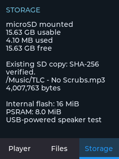

# Waveshare touchscreen MP3 player

Working USB-powered prototype for the **Waveshare ESP32-S3-Touch-LCD-2.8**:
240 x 320 touchscreen, microSD music storage, and the included speaker.

## Confirmed on hardware

- Screen text/colors, touch navigation, speaker playback, and pause/resume work.
- Player / Files / Storage tabs show the current song, files, and card space.
- Previous/next select a track; tapping an MP3 in Files starts playback.
- Audio runs on core 0; the touchscreen UI runs on core 1.
- The onboard analog knob adjusts volume; digital gain starts at 8%.
- ESP32-S3 with 16 MB flash and 8 MB PSRAM; 16 GB microSD detected.
- The test song is on the card as **`/Music/TLC - No Scrubs.mp3`**,
  **4,007,763 bytes**, verified against the original using SHA-256.
- Final app: 756,496 bytes. SHA-256:
  `9036136b32de294df1f86441afba242ca1c7efff3718f58835bfda095e4462d8`.

This verifies the stock speaker path powered over USB. **Battery operation,
charging-current changes, headphone conversion, external buttons, Wi-Fi song
uploads, and games are not implemented or validated by this test.**

## Music and storage

The MP3 itself, private flash backups, raw logs, and build outputs are not
published. To add songs, power off the player, use a card reader, and place MP3
files in a `Music` folder on a FAT32 microSD. Safely eject the card from the PC
before inserting it. Existing songs do not need the exact test-song filename.

The scanner searches through four subdirectory levels, with 128 initial tracks.
The file browser shows the first 128 entries in each folder. This prototype
does not expose the card as a USB drive and does not upload songs wirelessly.
The progress bar tracks compressed file position, not a parsed song duration;
there is no seek control. At the end of a track, Play restarts it.

For the original test only, an existing MP3 was placed in internal LittleFS as
`/test.mp3`. On startup, if that exact file is present, the firmware can copy it
to the card through a temporary file and verify its SHA-256 before renaming.
It reuses an identical existing copy, preserves different existing files, and
never formats a card on mount failure. The internal copy is retained as a
fallback. SHA-256 of the original MP3:
`700c4d7edc15c1d1a1fd8d69c93a7ae282ffd17c1aa626594aa25329b99adf18`.

## Pin map

| Function | ESP32-S3 GPIO |
| --- | --- |
| LCD MOSI / SCLK / CS / DC / reset | 45 / 40 / 42 / 41 / 39 |
| LCD backlight | 5 |
| Touch SDA / SCL / interrupt / reset | 1 / 3 / 4 / 2 |
| SDMMC CLK / CMD / D0 / D3 | 14 / 17 / 16 / 21 |
| Audio BCLK / LRCK / data | 48 / 38 / 47 |
| Battery latch control | 7; held low in this USB-only test |

SDMMC uses one-bit mode with D3 held high. Touch auto-detects CST328/CST3530.
Do not connect headphones directly to the stock bridged speaker terminals.

## Rebuild

Requirements: Python 3, PlatformIO Core, and a USB data cable. Run these commands
from this directory, substituting your connected board's port for `COM15`:

```powershell
python prepare_vendor.py
pio pkg install -e waveshare-speaker-test
python patch_audio_library.py
pio run -e waveshare-speaker-test
pio run -e waveshare-speaker-test -t upload --upload-port COM15
```

On the original laptop, PlatformIO's Python is
`%USERPROFILE%\.platformio\penv\Scripts\python.exe`, and `platformio.exe` is in
the same folder. Use that Python for the serial helpers; it includes pyserial.
The pinned toolchain is Espressif32 7.1.3 with Arduino-ESP32 2.0.17.

`prepare_vendor.py` restores LVGL 8.3.10 from the official Waveshare V2 demo ZIP
after checking the exact archive SHA-256. It omits the vendor's extra
`src/lv_conf.h`, so the build uses **`include/lv_conf.h`**. To reuse a local ZIP:

```powershell
python prepare_vendor.py --archive path\to\waveshare-v2-demo.zip
```

`patch_audio_library.py` makes an idempotent local change to ESP8266Audio 1.9.7:
disable the unused I2S MCLK output so GPIO0 remains available for BOOT. Run the
patch again if the dependency is reinstalled. No generated song is included.
The source/configuration here match the final physically verified build.

Do **not** upload a filesystem image just to play songs already on the card.
Only to reproduce the original internal-flash test, provide your own exact
`data/test.mp3`, then use PlatformIO `buildfs` / `uploadfs`. The partition table
reserves a 3 MB app and a 5 MB LittleFS filesystem; this differs from stock.

## Important display fix

The initial screen had rainbow-colored text despite clean framebuffer captures.
The cause was pixel byte order: **`LV_COLOR_16_SWAP=1`** produces MSB-first
RGB565, while the vendor LCD initialization used **RAMCTRL `0xE8`**, selecting
little-endian pixels. The final driver uses **`0xE0`** (bit 3 clear), matching
the buffer. The user physically confirmed that the colored chunks disappeared.

The LCD uses a conservative 20 MHz SPI clock, COLMOD `0x55`, and write-only
transfers. Lowering the clock or changing COLMOD alone did not fix the problem.
The backlight driver uses the Arduino 2.x LEDC API.

## Serial inspection

```powershell
python inspect_player.py --port COM15 --command status --seconds 8
python inspect_player.py --port COM15 --command storage --screenshot logs\storage.png
```

Commands: `status`, `pause`, `play`, `next`, `prev`, `player`, `files`, `music`,
`storage`, `shot`. The helper captures rendered pixels; a PNG alone does not
prove the physical display works. Audio, touch, and the final LCD fix were also
confirmed by the user. Helpers close the serial port when finished.



## Local restore points

The original working directory is `OneDrive\Documents\Independant Studies\MP3-speaker-test`
under the user's profile. These remain local and are excluded from this repo:

- `backups/factory-before-speaker-test.bin`: full pre-test 16 MB flash image.
  SHA-256: `6435b93df783961a82dd9bca01ff045baeff6321f09fa91135d88f756bd2d4af`.
- `backups/speaker-test-working/`: original screen-off test app, source, config,
  and LittleFS image.
- `backups/sd-player-working/`: final working SD/touch player app, source/config,
  and adapted vendor drivers.

To restore stock, validate the backup size (16,777,216 bytes) and checksum,
recheck the connected USB port, then run esptool from the original directory:

```powershell
python -m esptool --chip esp32s3 --port COM15 --baud 921600 write_flash 0 backups/factory-before-speaker-test.bin
```

If esptool is only installed through PlatformIO, invoke its `esptool.py` at
`%USERPROFILE%\.platformio\packages\tool-esptoolpy\esptool.py` using PlatformIO's
Python. A full stock restore replaces internal app/data; it does not erase the
removable card. Do not upload this project's filesystem over the stock layout.

## Sources and third-party code

- [Waveshare board documentation](https://docs.waveshare.com/ESP32-S3-Touch-LCD-2.8)
- [Official demo archive](https://files.waveshare.com/wiki/ESP32-S3-Touch-LCD-2.8/ESP32-S3-Touch-LCD-2.8-V2-Demo.zip)
- [ESP8266Audio 1.9.7](https://github.com/earlephilhower/ESP8266Audio/tree/1.9.7), GPL-3.0;
  license included under `licenses/`.
- LVGL 8.3.10, MIT; license included under `licenses/` and in the restored library.
- `src/vendor/` contains adapted Waveshare LCD/touch driver sources; their
  original headers are preserved. Changes are documented above.
- [Espressif ST7789 driver](https://github.com/espressif/esp-idf/blob/master/components/esp_lcd/src/esp_lcd_panel_st7789.c)
  documents RAMCTRL's little-endian flag as bit 3.
